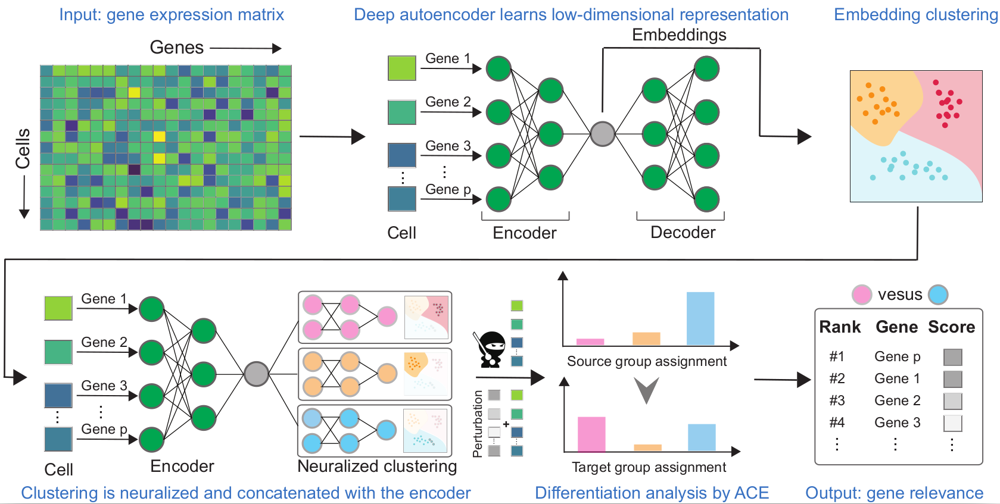

# ACE: Explaining cluster from an adversarial perspective

This repo contains the code of the paper titled "ACE: Explaining cluster from an adversarial perspective". 
Details are listed below:
 

# Description

At a high level, ACE attempts to answer the question, "For a given cell cluster, can we identify a subset of genes whose expression profiles are sufficient to identify members of this cluster?" by relying on the following three components: (1) an autoencoder to learn a low-dimensional representation of the scRNA-seq data, (2) a neuralized clustering algorithm to identify groups of cells in the low-dimensional representation, and (3) an adversarial perturbation scheme to explain differences between groups by identifying explanatory gene sets. The workflow employs a combined objective function to induce the nonlinear embedding and clustering jointly. ACE produces as output the learned embedding, the cell group assignments, and a ranked list of explanatory genes for each cell group.

Specifically, ACE first takes as input a single-cell gene expression matrix and learns a low-dimensional representation for each cell by using deep autoencoder. In this paper, ACE uses SAUCIE, a commonly-used scRNA-seq embedding method that incorporates batch correction. In principle, ACE is generalizable to any off-the-shelf scRNA-seq embedding methods. Second, ACE "neuralizes" the k-means clustering procedure by reformulating it as a functionally equivalent multi-layer neural network. In this way, in concatenation with a deep autoencoder that generates the low-dimensional representation, ACE is able to attribute the cell's group assignments all the way back to the input genes by leveraging gradient-based neural network explanation methods. Finally, ACE aims to induce, for each cluster identified by the neuralized k-mean algorithm, a ranking on genes such that highly ranked genes best explain that cluster. In doing so, ACE seeks small perturbations of its input gene expression profile that lead the neuralized clustering model to alter the group assignments. These adversarial perturbations allow ACE to define a concise gene set signature for each cluster or pair of clusters.

 

# Requirements
Python, tensorflow 1.x

# Dataset
All datasets can be downloaded from <a href="noble.gs.washington.edu/proj/ACE/"> here </a> 

# Contact
If you have any questions or suggestions about the code or manuscript, please do not hesitate to contact Yang Lu(`ylu465@uw.edu`)
and Prof. William Noble(`william-noble@uw.edu`). 

# Citation
Y.Y. Lu, T. Yu, G. Bonora, W.S. Noble (2021). "ACE: Explaining cluster from an adversarial perspective". International Conference on Machine Learning (ICML)
